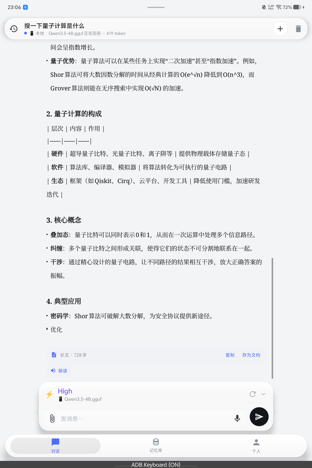
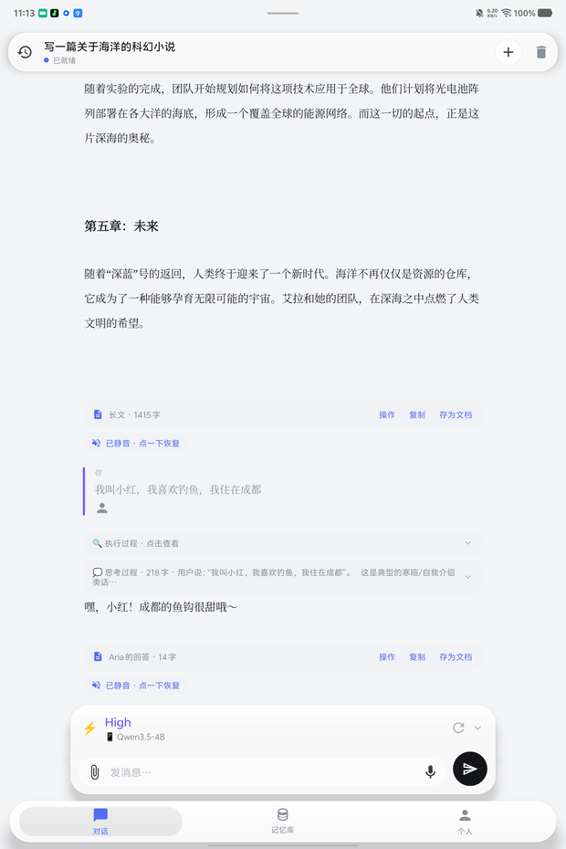
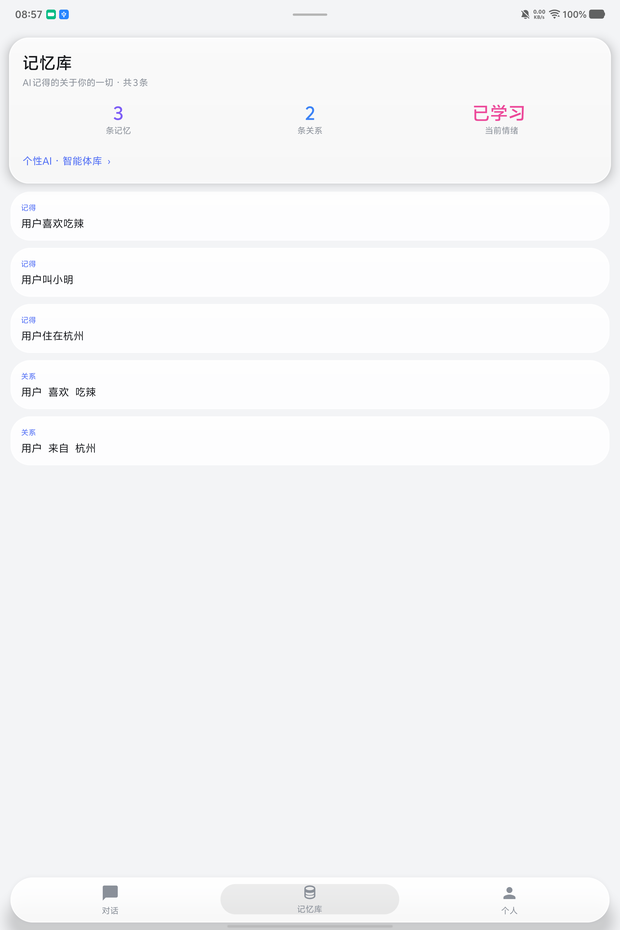
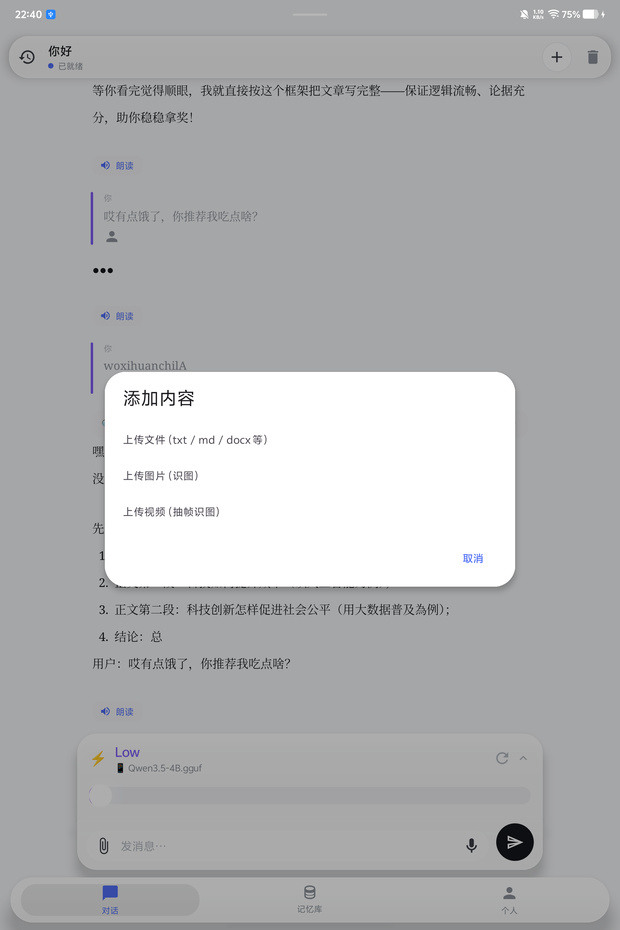

# Aria 2.0 纯净版

  

  <b>住在手机里的本地 AI。没有账号，没有云端，只有你和 Aria。</b>

  
  
  

> Designed & built by **没有蛋的神**

Aria 是一个在 Android 手机上本地运行大模型的 AI 聊天应用。模型下载到设备后，推理、对话、记忆都在本机完成；不需要注册账号，也不依赖云端服务。

本仓库用于分发 **Aria 2.0 纯净版** 安装包与版本说明。

## 下载

- **最新版**：[Releases](https://github.com/caiyepeng/aria-2.0-clean/releases/latest)
- **直接下载**：[Aria-2.0-clean.apk](https://github.com/caiyepeng/aria-2.0-clean/releases/download/v2.0-clean/Aria-2.0-clean.apk)
- 版本：`2.0-clean`（versionCode 2）
- 大小：约 51.7 MB
- 要求：Android 13+（API 33），arm64 设备
- SHA256：`2BAADEE262069F5320D08AAEABE40196D624A21FAC1001A5C0C07A8F4BD3FBE6`

> 安装包不包含模型文件。首次启动后需要在应用内下载或导入 GGUF 模型。

## 它能做什么

- **本地大模型对话**：基于 llama.cpp / GGML，在手机 CPU 上直接跑 GGUF 模型，支持流式输出
- **模型中心**：查看设备算力与内存建议，下载推荐模型，或导入自己的 `.gguf`
- **思考过程**：可展开查看模型的思考与执行过程，长回答支持复制、存为文档
- **记忆库**：从对话中记住关于你的事实与关系，形成长期上下文
- **角色智能体**：切换不同角色/智能体，让 Aria 以不同方式陪你聊天
- **朗读与语音**：回答可朗读，输入支持语音
- **多类型附件**：上传 txt / md / docx、图片识图，或视频抽帧识图
- **对话历史**：本地保存历史会话，支持搜索与继续之前的话题
- **Markdown 渲染**：表格、列表、代码块与长文排版

## 界面

| 本地对话 | 思考过程 | 记忆库 |
| --- | --- | --- |
|  |  |  |

  

## 安装与第一次使用

1. 从 [Releases](https://github.com/caiyepeng/aria-2.0-clean/releases/latest) 下载 `Aria-2.0-clean.apk`
2. 在手机上允许「安装未知来源应用」，完成安装
3. 打开 Aria，进入模型中心
4. 下载一个推荐模型，或导入本地 `.gguf` 文件
5. 等待模型加载完成，即可开始对话

建议在 Wi-Fi 下下载模型。4B 级别的 Q4 量化模型通常需要数 GB 存储空间和 4 GB 以上可用内存；手机性能越好，生成速度越快。

## 隐私

- 模型推理在本机完成，对话内容不会上传到云端
- 没有账号系统，不需要登录
- 对话、记忆、设置与模型都保存在设备本地
- 只有在下载模型或主动访问网络资源时才会使用网络
- 麦克风权限仅用于语音输入，可拒绝授权并继续使用文字聊天

卸载应用会同时删除应用私有目录中的对话与记忆，重要内容请先在应用内导出备份。

## 关于「纯净版」

- 应用名：**Aria 纯净版**
- 包名：`com.example.llama.aichat.clean`
- 与完整版使用不同包名，可以同时安装
- 本版本不含内置模型，安装包更轻，模型由你自行选择

## 常见问题

**安装时提示“应用未安装”或“未知来源”？**  
请在系统设置中允许当前文件管理器/浏览器安装应用；部分品牌手机还需要关闭「纯净模式」或「安全守护」的拦截。

**模型加载失败 / 闪退？**  
先确认机型和内存是否足够，尝试更小的量化模型（如 2B / 4B Q4），并确保下载的 `.gguf` 文件完整。

**生成很慢？**  
本地推理速度取决于手机 CPU 与内存带宽。关闭后台应用、选择更小的模型通常能明显改善。

**为什么没有内置模型？**  
模型文件体积大、型号多。把选择权留给用户，也避免安装包膨胀到数 GB。

---

  Aria 2.0 纯净版 · Made by 没有蛋的神

